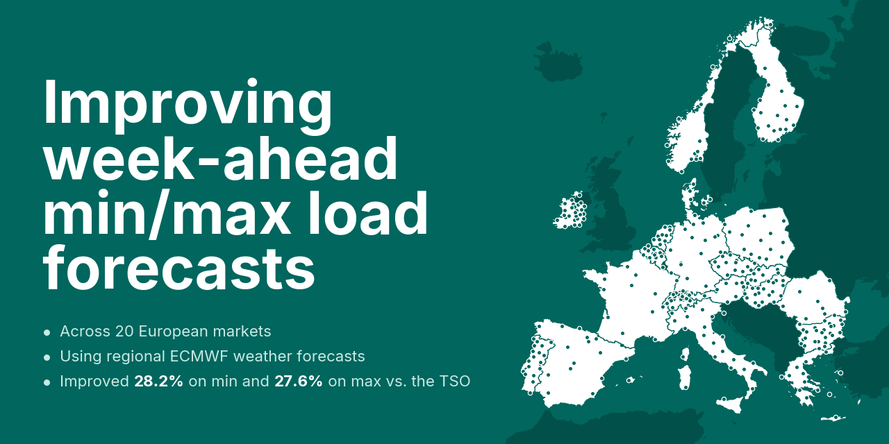

# improving-week-ahead-min-max-load-forecasts



Research code for improving week-ahead forecasts of daily minimum and maximum electricity load across 20 European markets.

Transmission system operators publish their own week-ahead minimum and maximum load forecast as the ENTSO-E A31 series, issued every Friday for the following Monday to Sunday, which covers horizons of three to nine days ahead. This repository fits rolling-window LASSO models on calendar, load-lag, TSO-forecast and ECMWF weather features and scores them against that operational TSO benchmark.

## Requirements

Python 3.10 or newer. The interpreter is pinned in `.python-version`, the dependency list is in `pyproject.toml` and the exact versions used are in `uv.lock`.

```bash
uv sync
```

Then either activate `.venv` or prefix each command below with `uv run`. Without uv, `pip install -e .` installs the same dependency list, unpinned.

The GRIB reader in step 1b needs the ecCodes library. On Linux and macOS it is installed automatically as `eccodeslib`. That package publishes no Windows wheels, so on Windows install ecCodes from conda-forge first, or run step 1b under WSL. Steps 1c to 4 do not need it.

```bash
conda install -c conda-forge eccodes
```

Two API keys are read from the environment by the download steps. No key is stored in this repository.

| Variable | Used by | Source |
|---|---|---|
| `ECMWF_API_KEY` | `1a_download_ecmf.py` | personal access token of an [ECMWF Data Store](https://ecds.ecmwf.int) account that has accepted the TIGGE licence |
| `ENTSOE_API_KEY` | `1c_download_load.py` | security token of an [ENTSO-E Transparency Platform](https://transparency.entsoe.eu) account with RESTful API access |

## Pipeline

Run every command from the repository root, in order.

```bash
python 1a_download_ecmf.py     # ECMWF TIGGE HRES, Jan 2021 to Feb 2026  -> data/ecmwf_grib/
python 1b_extract_ecmf.py      # GRIB to per-region point CSVs           -> data/ecmwf_points/
python 1c_download_load.py     # ENTSO-E load and A31 forecast, 15-min    -> data/raw/
python 1d_prepare_features.py  # one row per day, anchored at local noon  -> data/features/
python 2_run_models.py         # rolling-window LassoCV and benchmarks    -> models/
python 3_evaluate_extremes.py  # MAE and RMSE of every forecaster         -> results/extremes_errors.csv
python 4_dm_test.py            # Diebold-Mariano tests against the TSO    -> results/dm_significance.csv
```

Steps 1a to 1c hit rate-limited external APIs and are slow. The TIGGE download in 1a alone takes weeks, and it skips the months it already has, so it can be restarted. Together the three steps leave about 50 GB on disk, most of it the GRIB files. Steps 1d to 4 run offline from whatever those produced.

Step 2 writes, per market, the forecasts of every specification and benchmark in `models/{CC}_direct.csv`, and every nonzero coefficient and the selected penalty of every fit in `{CC}_direct_coefs.csv` and `{CC}_direct_fits.csv`. It skips markets whose output already exists, so an interrupted run resumes where it stopped.

Step 4 tests every model against the TSO forecast. The article's comparisons along the 2x2 weather design test the specifications against each other instead.

```bash
python 4_dm_test.py --reference capital_temperature
python 4_dm_test.py --reference capital_nwp
python 4_dm_test.py --reference regional_temperature
```

Each writes `results/dm_significance_vs_{reference}.csv`.

**Compute.** Step 2 fits 232,960 models (20 markets, 104 issue Fridays, 7 horizons, 2 targets, 8 forecasters), about 1.1 s of CPU per LASSO fit, so roughly 50 core-hours spread over all available cores. On the server the article's results were computed on, an AMD EPYC 7713 (one socket, 64 cores, 128 threads) with 251 GiB of RAM running Zorin OS 18.1 (Ubuntu-based Linux), step 2 restricted to 64 of the 128 hardware threads took just under an hour (3,503 s).

**Exactness.** LassoCV is deterministic (plain 7-fold `KFold`, cyclic coordinate descent), so under the versions in `uv.lock` the same feature frames give the same forecasts. On a different numeric stack, near-tied penalty choices can move a small share of forecasts by a few MW.

## Output files in this repository

The repository ships the article's run from step 1d onward, so every number in the article can be recreated without downloading anything.

| Path | Contents |
|---|---|
| `data/features/data_{CC}.csv` | the daily feature frames of step 1d, which step 2 fits on |
| `models/{CC}_direct.csv` | the forecasts of every specification and benchmark, with the realized daily extremes and the TSO's A31 forecast |
| `models/{CC}_direct_fits.csv` | the selected penalty, the number of nonzero terms and the target scaling of every fit |
| `results/` | the scores of step 3 and the Diebold-Mariano tests of step 4 |

Running step 2 on the shipped feature frames reproduces the shipped forecasts and fit statistics byte for byte (checked on Linux with the versions in `uv.lock`), and steps 3 and 4 run directly on the shipped forecasts. The coefficient export (`models/{CC}_direct_coefs.csv`, about 770 MB) is not shipped; step 2 writes it again.

The downloads of steps 1a to 1c are not shipped. Load and the A31 forecasts come from the [ENTSO-E Transparency Platform](https://transparency.entsoe.eu), the weather from [ECMWF TIGGE](https://confluence.ecmwf.int/display/TIGGE), each under its own terms of use.

**Rerunning from the downloads.** The shipped files are built from ENTSO-E data downloaded in August 2026, and ENTSO-E could revise some of it since.

## What is being fitted

One `LassoCV` is fitted per (country, specification, issue week, horizon, target).

| Setting | Value |
|---|---|
| Training window | 1092 days, rolling |
| Test window | issue Fridays 2024-01-05 to 2025-12-26 |
| Horizons | d+3 to d+9, Monday to Sunday of the following week |
| Targets | daily minimum and maximum of the 15-min load, the TSO's own measurement |
| Markets | 20 |
| Row anchor | local 12:00, the assumed Friday issue time |

Every specification extends the same base predictor set of calendar terms, hourly load lags, hourly TSO leads, daily load extremes and the TSO's own A31 forecasts. The four weather specifications cross spatial coverage with the set of weather variables.

| Specification | Weather predictors |
|---|---|
| `base` | none |
| `capital_temperature` | 2-m temperature at the capital |
| `regional_temperature` | 2-m temperature averaged over all regions |
| `capital_nwp` | six ECMWF variables, precipitation and heating and cooling degree days at the capital, nine regressors |
| `regional_nwp` | the same nine regressors, averaged over all regions |
| `regional_nwp_lag1_no_tso` | `regional_nwp` without the hourly TSO leads and with only the most recent hourly load lag, 63 predictors instead of 266 |

Two reference benchmarks are fitted alongside them.

| Benchmark | Form |
|---|---|
| `unbiased` | the TSO forecast plus a fitted offset, with the slope held at one |
| `expert` | weekday structure, TSO levels for the run day and the target day, two extreme lags and capital temperature, by OLS |

## Configuration

`model_config.py` holds every modeling parameter and the column-name templates. Those templates are the single source for every derived column name in the pipeline. Step 1d builds the columns from them and every later script selects the columns back by the same templates, so a rename in one place propagates through the whole pipeline.

`country_config.py` holds the 20 markets and one latitude and longitude weather-sampling point per administrative region. Every script imports it, so region counts cannot drift apart between the sampling map and the tables.
